# nxnative-android

Port your own Nintendo Switch games to Android. The game's ARM64 code runs natively, with Horizon services provided by the host and NVN graphics replayed through Vulkan. This fork builds on [shirai91/nx2android](https://github.com/shirai91/nx2android) and [seedds/nxnative](https://github.com/seedds/nxnative), retaining their attribution and MIT license.

**[中文说明](README.zh-CN.md)** · [Downloads](https://github.com/shenmintao/nxnative-android/releases) · [Game status](docs/PORT_STATUS.md) · [Install guide](packaging/INSTALL.md)

The current candidate is **0.3.0rc1**. The Windows bundle starts with `nxnative-android.exe`; a source checkout starts with `nxnative-android.cmd` or `python -m nxnative_android`. It includes no games or keys.

## What this fork adds

- Direct NSP/XCI import, matching updates and DLC to the selected game; upstream NSZ/XCZ decompression remains available.
- A single APK by default, or `--data-mode external` for large games. The complete standalone APK must be smaller than 4 GiB (ZIP32).
- Touch controls, controller detection, Android text input, game rumble and real device gyro/accelerometer input. BotW's scope direction and stability were checked on the physical tablet.
- Graphics **and compute** pipeline prewarming, upstream lock-poll spin waits, and the retained Vulkan performance stack. The extra sync-caller affinity experiment is disabled; asynchronous compilation that skips draws stays disabled by default.
- Upstream rendering fixes and ADPF hints, including GPU workload reporting where the Android API supports it.

## BotW 1.9.0: verified scope

Tested on **TB323FU, SM8850P / Adreno 840, Android 16, balanced mode**, using the owned Great Plateau save. Docked output is **1920×1080**; the game retains its **1280×720–1600×900** dynamic internal resolution (1600×900 in the measured scenes).

| Final debug measurement | Average fps | Late intervals (>17.5 ms) | Intervals >50 ms |
|---|---:|---:|---:|
| Fixed view, two 120 s windows | 59.895 | 0.647% | 0 |
| Moving route, two 120 s windows | 59.830 | 0.829% | 0 |
| First start, moving, one 120 s window | 59.875 | 0.751% | 0 |

The final package passed 150 unit tests, Vulkan validation with zero errors (three unused-output warnings), and a release save/load smoke test. The user waived the final 30-minute soak; it was **not run**. Full-game compatibility is unverified and a lower-leg ground-occlusion issue remains, so BotW stays **work in progress**. These results do not establish native internal 1080p or the performance of another device. [Acceptance and experiment record](docs/perf-plan-2.md).

**Subsequent user-play regression (2026-11-02):** a different Great Plateau route still stutters. A 120 s diagnostic capture measured 58.004 fps, 33 intervals over 50 ms and 12 over 100 ms (maximum 241.680 ms). Surrounding runtime checkpoints show 388 additional graphics pipeline creations after startup prewarm; their per-frame cost has not yet been isolated. The short acceptance route does not cover this behavior. Release packaging/publication is held for investigation.

## Hardware compatibility

The ARM64 runtime and generic lock rule are shared across SoCs. This fork's final BotW measurements are specific to SM8850P; upstream separately tested an Adreno 830 device. A Snapdragon 8 Elite / SM8750 needs its own performance check.

**Dimensity 9400 / Immortalis-G925 is under investigation on a separate branch.** The connected device reports ASTC support but no BC texture sampling or descriptor-buffer extension. The renderer has CPU BC decoding and descriptor-set fallbacks, but the current installer still enforces profiles' `bcn` requirement. Mali is not yet a verified release target. CPU BC decoding also increases texture memory; no Mali fps claim is made here.

## Games

The gallery below preserves **upstream nx2android test records**, primarily from a Lenovo Legion Y700 (Snapdragon 8 Elite / Adreno 830). They are not a fresh test of every game in this fork. BotW's local results and limitations are recorded above and in [PORT_STATUS.md](docs/PORT_STATUS.md).

| | |
|:---:|:---:|
|  13 Sentinels: Aegis Rim `v0.1.3` · update 1.10 · 60 fps |  Advance Wars 1+2: Re-Boot Camp `v0.1.3` · base game 1.0.0 · 60 fps (30 in battle on Switch) |
| 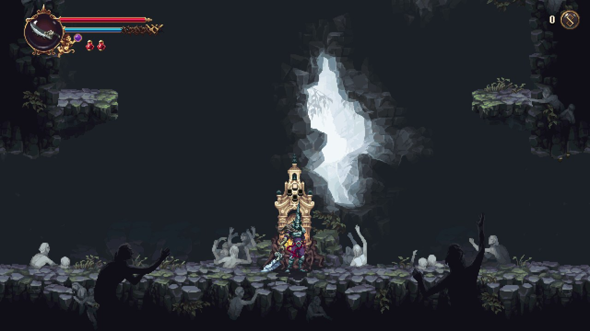 Blasphemous 2 `v0.1.3` · update 1.0.8 · 60 fps | 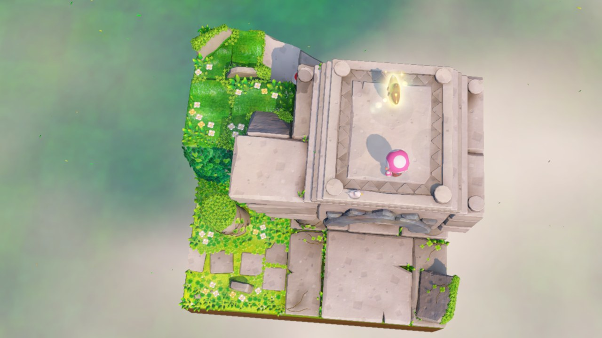 Captain Toad: Treasure Tracker `v0.1.3` · update 1.4.2 · 60 fps |
| 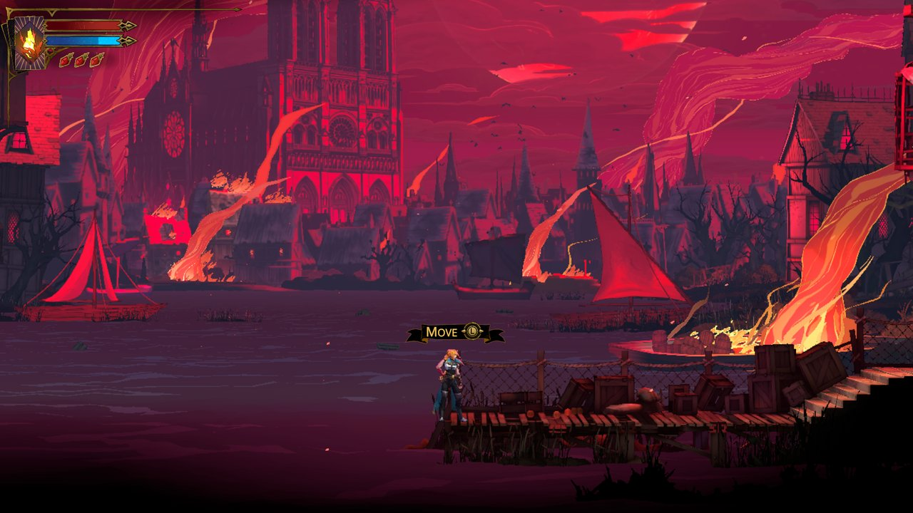 Castlevania: Belmont's Curse `v0.2.0` · update 1.1.0 · 60 fps | 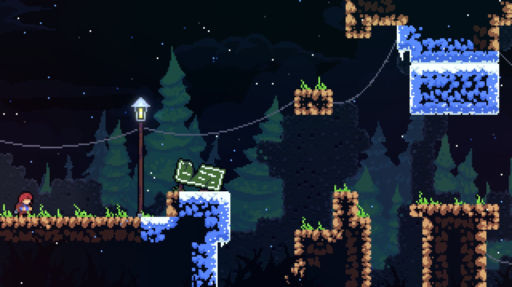 Celeste `v0.1.3` · update 1.4.1.1 · 60 fps |
|  Donkey Kong Country Returns HD `v0.1.3` · update 1.1.0 · 60 fps |  Graveyard Keeper 2 `v0.1.2` · update 1.0.4 · 60 fps (30 on Switch) |
|  Hades II `v0.1.2` · update 1.0 · 60 fps | 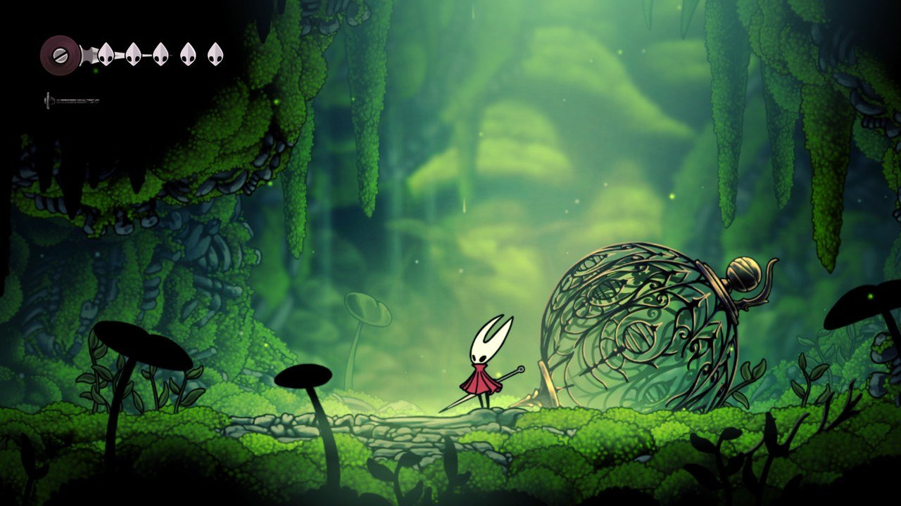 Hollow Knight: Silksong `v0.1.3` · update 1.0.30000 · 60 fps |
|  Mario vs. Donkey Kong `v0.1.3` · update 1.0.1 · 60 fps | 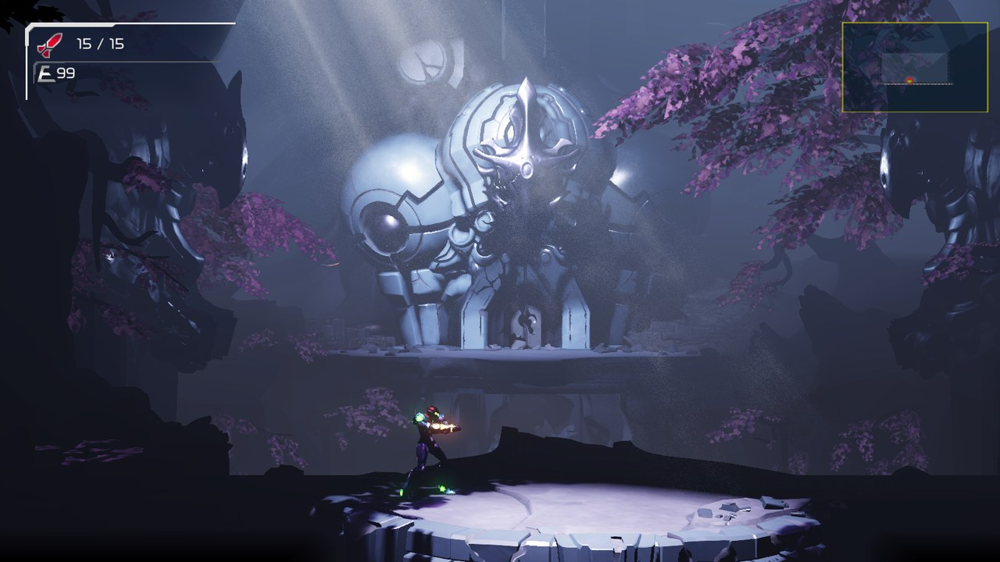 Metroid Dread `v0.2.0` · update 2.1.0 · 60 fps |
|  NEO: The World Ends with You `v0.1.2` · update 1.03 | 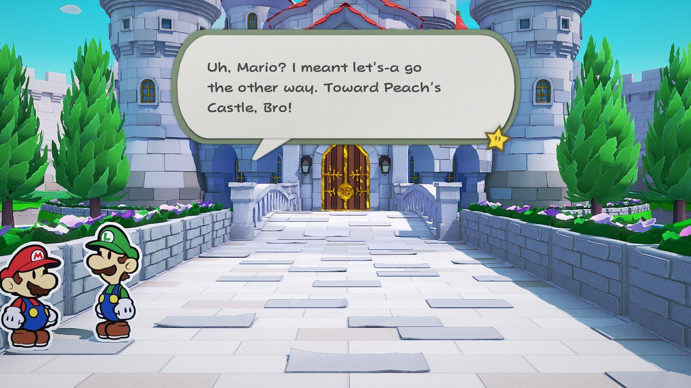 Paper Mario: The Origami King `v0.2.0` · update 1.0.1 · 60 fps (30 on Switch) |
| 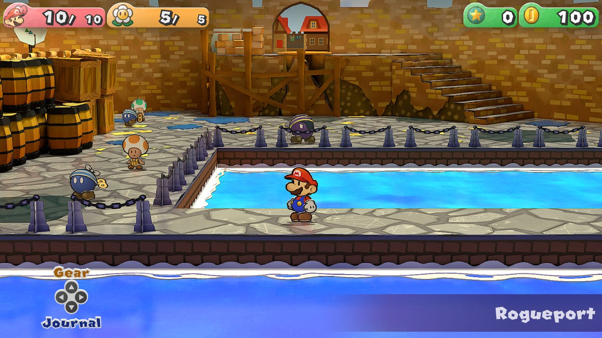 Paper Mario: The Thousand-Year Door `v0.2.0` · update 1.0.1 · 60 fps (30 on Switch) · **work in progress**: playable, but lighting flickers (walls go black for single frames after a fall) | 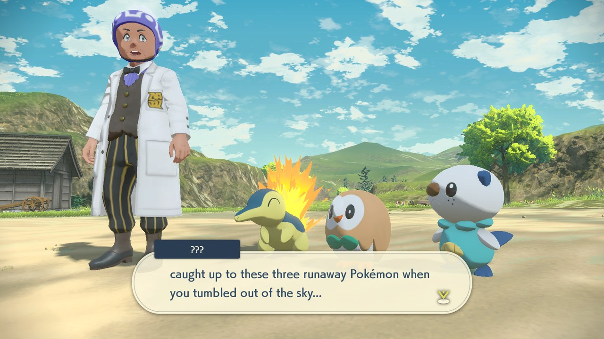 Pokémon Legends: Arceus `v0.2.0` · update 1.1.1 · 60 fps (30 on Switch) |
|  Super Mario Bros. Wonder `v0.1.3` · update 1.2.1 · 60 fps, dips to 40 | 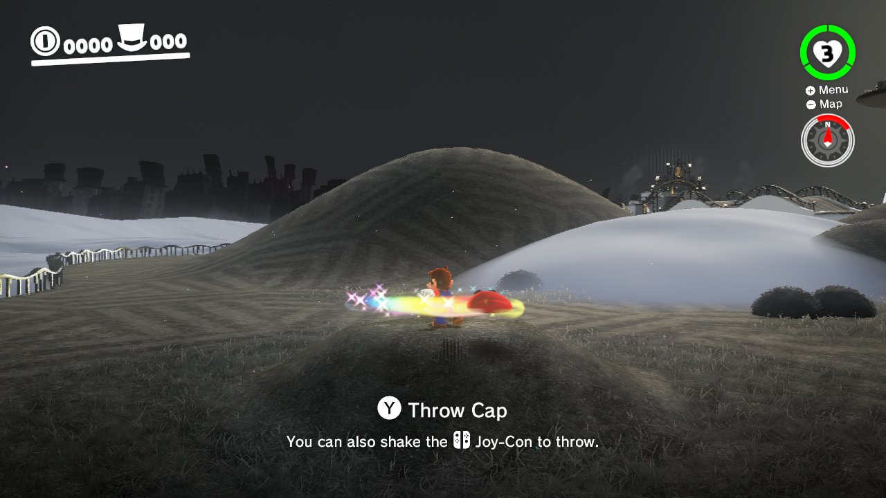 Super Mario Odyssey `v0.2.0` · update 1.4.1 · 60 fps · shake the device to throw Cappy |
|  Tales of Eternia Remastered `v0.1.2` · update 2.0.0 · 60 fps | ![UNDER NIGHT IN-BIRTH Exe:Late[cl-r]](docs/images/under-night-in-birth-exe-late-cl-r.jpg) UNDER NIGHT IN-BIRTH Exe:Late[cl-r] `v0.2.0` · update 1.0.3 · 60 fps |
| 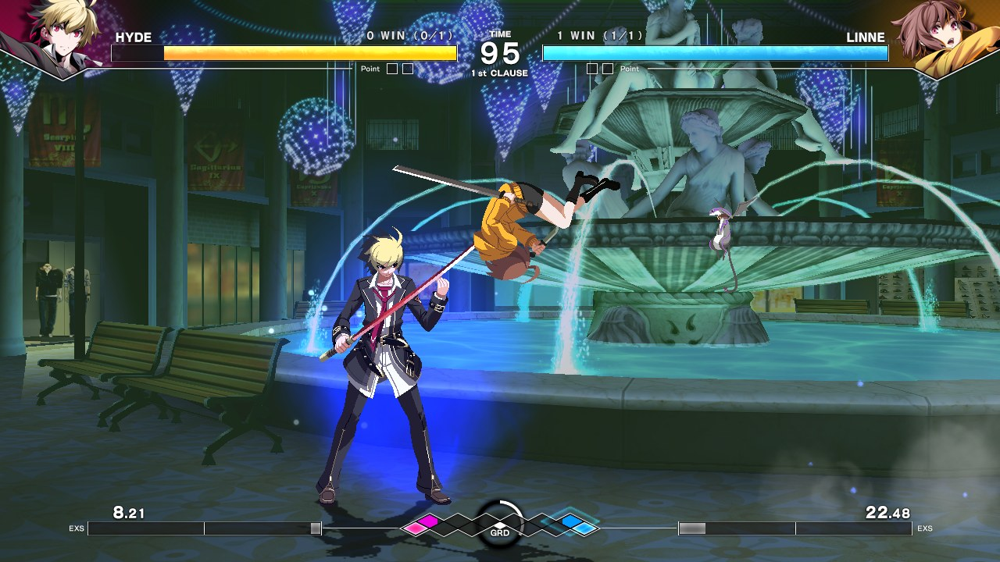 UNDER NIGHT IN-BIRTH II Sys:Celes `v0.2.0` · update 1.42 · 60 fps |  Unicorn Overlord `v0.1.3` · update 1.05 · 60 fps · **boots**: saving and a full battle not tested yet |
|  Unpacking `v0.1.2` · update 2.01 · 60 fps · played by touch |  Viractal: Will You Trust Your Party? `v0.1.0` · update 1.4.5 |
|  Xenoblade Chronicles 3 `v0.1.0` · update 2.2.0 · 30 fps · **work in progress**: some effects and models don't draw yet | |

The tag (`v0.1.3`) is the latest nx2android version the game was tested on. Older games are not tested again for each release: if a later version breaks one, a patch release fixes it. A tag newer than the [latest release](https://github.com/shirai91/nx2android/releases/latest) is the next release, and the game needs the development checkout until it ships.

A game without an Android profile is experimental. The games we look at next, and the ones done: [docs/PORT_CHECKLIST.md](docs/PORT_CHECKLIST.md).

## For players: port a game without programming

1. Download `nxnative-android-<version>-windows-x64.zip` from this fork's [Releases](https://github.com/shenmintao/nxnative-android/releases), unzip it and start **nxnative-android.exe**. The build scripts also support macOS, but this candidate's local bundle verification covers Windows only.
2. **Setup** tab: click **Download missing tools** (the Android NDK, the .NET SDK and platform-tools, about 1 GB, from Google and Microsoft), then set your **prod.keys**. Every line turns green.
3. **Port** tab: choose the folder with the game's NSP, XCI, NSZ or XCZ files (base game, update, DLC) and click **Port**.
4. Tick **Install on the device when done** with the device plugged in and USB debugging on, or copy the APK and the data folder yourself.

A game played by touch: tick **Touch game** on the Port tab (`--touch`). The on-screen gamepad then starts hidden and every touch but one on the menu button goes to the game; the pause menu shows the gamepad again.

To arrange the on-screen controls, open the pause menu's **Gamepad** tab and choose **Edit layout**: drag a control to move it, pinch or use **− / +** to resize it. **Save** keeps the layout for the next launch and **Cancel** discards your edits. **Snap to grid** (off at first, and remembered) shows a square grid and snaps each control's center to it as you drag.

A game that crashes with "AllocateAddressRegion … refused (0x1803)" in its log needs more address space: port it again with a larger **Extra address space** on the Port tab (`--alias-headroom` on the command line). [packaging/INSTALL.md](packaging/INSTALL.md#when-something-goes-wrong) says more.

The step-by-step guide is [packaging/INSTALL.md](packaging/INSTALL.md). You need your own game files and `prod.keys`, dumped from your own Switch; the tool never ships or downloads either. NSZ and XCZ files are decompressed during the port (into the build folder's `tmp/`, deleted once extracted).

## Saves

The game's pause menu (Game tab) has **Export save** and **Import save**: an export is a folder in `Android/data/<package>/files/saves/` on the device, the save's files as a console's save tools copy them, so a save from a console imports the same way. The app's **Saves** tab moves them between the device and the PC.

An import replaces the save the game has; the app exports that one first on the device (a folder ending `-before-import`). Uninstalling the app deletes its saves and its exports: copy them to the PC first.

## For developers

Running from the repository, the command line, the repository layout, building the bundle, tests and commit messages: [docs/DEVELOPMENT_GUIDE.md](docs/DEVELOPMENT_GUIDE.md). How it is put together: [docs/ARCHITECTURE.md](docs/ARCHITECTURE.md).

## Keys and game files

nxnative-android reads your own game files with your `prod.keys` while it ports them. This repository and its releases contain no keys or game files, and the tool never downloads either. Keep generated game APKs and data packs private.

## License

MIT, as nxnative (see `nxnative/LICENSE`). Third-party code keeps its own license.
